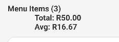
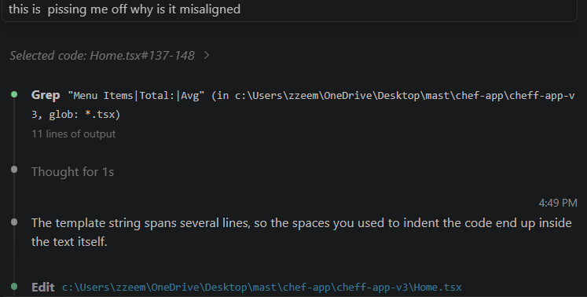
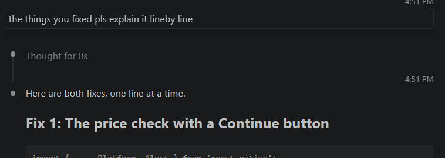

# Chef's Menu Manager

**Module:** MAST5112 – Mobile App Scripting
**Assessment:** PoE Part 2 – Building the Mobile Application
**Student:** Mohamed Zaeem Motala (ST10515004)

> **Submission note:** this repository is my **PoE Part 2** submission. Besides the Part 2 requirements (add and view menu items, with validation and feedback messages), it also includes search, edit and delete features that I built ahead of the Final PoE.

## About the app

Chef's Menu Manager is a React Native (Expo) Android app built for Christoffel, a restaurant owner whose chef currently keeps menu information on paper. The app lets the chef capture dishes on a phone and see the whole menu in one place.

The app code is in the [`cheff-app-v3`](./cheff-app-v3) folder.

## Features

- Add a menu item with a dish name, cooking time, description, price and dish type.
- Pick the dish type from a dropdown (Appetizer, Main Course, Dessert, Beverage).
- Validation on every field, with a clear error message for each:
  - the name, time, description, price and dish type are all required
  - the price must be a number greater than 0
- A success message ("Dish added successfully!") after a dish is saved.
- A price check: if the price is over R400, the chef is asked to confirm it and can press Cancel to change it or Continue to save the dish anyway.
- The menu list updates straight away when a dish is added, and the list is saved on the device with AsyncStorage, so it is still there when the app is reopened.
- A summary line showing the number of dishes, the total price and the average price.
- A Details screen (opened with the **Details** button) that groups dishes by type and shows a count and average price for each type.
- Extras beyond the Part 2 requirements: search by dish name, edit a dish, delete a dish.

## Screens

| Screen  | Purpose                                                              |
| ------- | -------------------------------------------------------------------- |
| Home    | Form for adding dishes, search bar, and the list of menu items       |
| Details | Menu summary and dishes grouped by dish type                         |

Navigation uses React Navigation (native stack): Home → Details.

## Tech stack

- React Native 0.86 with Expo SDK 57
- TypeScript
- React Navigation (native stack)
- `@react-native-picker/picker` for the dish type dropdown
- `@react-native-async-storage/async-storage` for saving the menu

## How to run

1. Install [Node.js](https://nodejs.org/) and the Expo Go app on your Android phone (or set up an Android emulator).
2. Clone the repo and go into the app folder:
   ```
   git clone https://github.com/EMGPSD/mast5112-2026-part-2-st10515004.git
   cd mast5112-2026-part-2-st10515004/cheff-app-v3
   ```
3. Install the dependencies:
   ```
   npm install
   ```
4. Start the app:
   ```
   npx expo start
   ```
5. Scan the QR code with Expo Go, or press `a` to open it on an Android emulator.

## How the code works

This section explains the main ideas behind the search box and the menu list in `Home.tsx`.

### Searching the menu

1. **A state variable stores what the chef types.** `const [searchItem, setSearchItem] = useState('');` creates it, and it starts as an empty string.
2. **The search box keeps that state up to date.** The `TextInput` is given `value={searchItem}` and `onChangeText={(text) => setSearchItem(text)}`. Each time a key is pressed, `setSearchItem` saves the new text. Changing state makes React run the component again (a re-render), so the screen always shows the latest results.
3. **`.filter` builds the list that is shown.**

   ```tsx
   const displayedItems = menuItems.filter((dish) =>
     dish.name.toLowerCase().includes(searchItem.toLowerCase().trim())
   );
   ```

   `.filter` goes through the dishes one at a time and asks a yes/no question about each one: does this dish's name contain the search text? Dishes that answer yes are kept and the rest are left out. In this code:
   - `.toLowerCase()` is applied to both the name and the search text, so capital letters are ignored ("pasta" still finds "Pasta").
   - `.trim()` removes spaces from the start and end of the search text.
   - `.includes(...)` is true when the search text appears anywhere in the name.

   When the search box is empty, every name contains an empty string, so every dish is kept.

How it all fits together:

```
type "pa" → setSearchItem("pa") → component re-renders
          → filter keeps only names containing "pa"
          → displayedItems = [Pasta, Paella]
          → .map draws a card for each
```

The full list (`menuItems`) is never changed by a search. Each re-render only creates a temporary filtered copy.

### Showing a message when the list is empty

The list uses a ternary operator, which is a short if/else that returns a value:

```
condition ? valueIfTrue : valueIfFalse
```

Because it is an expression, it can sit directly inside the JSX. React gets exactly one thing to display:

```tsx
{displayedItems.length === 0 ? (          // is there nothing to show?
  <Text>...message...</Text>              // yes → show a message
) : (                                     // no → ...
  displayedItems.map((item) => (...card...))   // ...show one card per dish
)}
```

If the list is empty, a single message is shown ("No matching dishes found." during a search, or "No menu items available. Please add a new dish." when the menu is empty). Otherwise React shows the array of cards created by `.map`. The brackets around each branch are only there so the code is easier to read.

### Drawing the cards with `.map`

`.map` is a built-in array method. It goes through the array one item at a time, runs a function on each item, and returns a new array made of the results. The original array is not changed.

```ts
const prices = [50, 80, 120];
const doubled = prices.map((p) => p * 2);
// doubled = [100, 160, 240]
```

In the app, `displayedItems.map((item) => ...)` returns a `<View>` card for each dish, filled with that dish's own name, time, description, price and type. With three dishes it returns three cards, and React draws them one under the other:

```
displayedItems = [
  { name: 'Pasta', price: 12, ... },   → card 1: Pasta, R12
  { name: 'Steak', price: 45, ... },   → card 2: Steak, R45
  { name: 'Cake',  price: 30, ... },   → card 3: Cake, R30
]
```

Each card is given `key={item.id}`. React needs a unique key on every item in a rendered list so it can tell the cards apart. That way, when one dish is edited or deleted, only that card is updated. Without keys, React shows a warning.

Whenever `displayedItems` changes (a dish is added, edited or deleted, or the search text changes), React runs the `.map` again from the start and redraws the list with the new data.

### Confirming a high price

I wanted the app to warn the chef when a price looks too high, but not to block it, because a dish over R400 is still possible. My first attempt was:

```tsx
if (!price || Number(price) > 400) { alert('Are you sure about the price?'); return; continue; }
```

This did not work, and I used an AI assistant (Claude) (Anthropic, 2026a) to help me understand why. What I learned:

- `continue` only works inside a loop, so it caused an error here. It also came after `return`, so it could never have run.
- `alert()` can only show a message with an OK button. It cannot give the user a choice, so it could not offer "go back" or "carry on".
- `!price` was in the same check, so an empty price showed "Are you sure about the price?" instead of "Please enter a price".

The fix in `Home.tsx`:

1. The checks for an empty price and for a valid number now run first.
2. If the price is over 400, the app shows a pop-up with two buttons, **Cancel** and **Continue**, and waits for the answer:
   - **Continue** saves the dish as normal, so the chef is not stuck with a R400 limit.
   - **Cancel** saves nothing and keeps the form filled in so the price can be changed.
3. `Alert` was added to the `react-native` import. On the web, the browser's built-in `confirm` box is used instead, because `Alert.alert` buttons do not work in a browser.

### Fixing the misaligned summary text

The summary above the menu list showed up misaligned: "Total" and "Avg" were pushed to the right of "Menu Items". I could not work out why, so I asked Claude Code (the Claude assistant inside my code editor) (Anthropic, 2026d). Claude Code does not have a share-chat link, so I have saved screenshots of the conversation in the [`screenshots`](./screenshots) folder.







**The cause:** the text was written as a template string (text inside backticks) that continued over several lines. A template string keeps everything exactly as typed, so the spaces I used to indent the code ended up inside the text itself and pushed "Total" and "Avg" to the right.

**The fix:** the text is now written on one line, with `\n` marking where each new line starts. The result is `Menu Items (3)`, then `Total: R50.00`, then `Avg: R16.67`, all lined up.

```tsx
`Menu Items (${menuItems.length})\nTotal: R${totalPrice.toFixed(2)}\nAvg: R${averagePrice.toFixed(2)}`
```

After the fix I asked Claude Code (Anthropic, 2026d) to explain each change line by line so that I understood it, and not only copied the answer.

## Design decisions and changes from Part 1

- **Dish types.** The app uses four dish types: Appetizer, Main Course, Dessert and Beverage. My Part 1 design used three courses, and I added Beverage and used the label "Appetizer" because more variety makes it easier for the chef to organise the menu. The picker, the menu cards and the Details screen all use the same four types.
- **Splash screen.** While the app starts up, my chef-hat logo is shown on a plain white splash screen. It is set up with the `expo-splash-screen` plugin and the `splash-icon.png` image.
- **Messages.** Validation errors, the high price confirmation and the success message tell the chef what happened after every action.

## Video demonstration

YouTube (Unlisted): _add your link here_

## References

I used Google to find out how to install and set up the AsyncStorage, Picker and React Navigation packages (Google, 2026a). The installation steps came from the official documentation for each package (React Native Async Storage, n.d.; React Native Community, n.d.; React Navigation, n.d.). I also used a Google search to find the command for installing the splash screen (Google, 2026b). The app icon and loading screen image were generated with the help of Grok (xAI, 2026), and I used Claude as a coding and learning aid (for example, to understand and fix the price confirmation and the misaligned summary text described above) and to help format my work and understand the assignment brief (Anthropic, 2026a; 2026b; 2026c).

Anthropic. 2026a. Claude (Sonnet 5.5). [Large language model]. Available at: https://claude.ai/share/321c6eac-e7e9-4270-8f79-43b30c067c0e [Accessed: 11 October 2026].

Anthropic. 2026b. Claude (Sonnet 5.5). [Large language model]. Available at: https://claude.ai/share/6830cd57-0ae1-4700-ba99-6ee67f2e0ea3 [Accessed: 11 October 2026].

Anthropic. 2026c. Claude (Sonnet 5.5). [Large language model]. Available at: [PASTE THIS CHAT LINK HERE] [Accessed: 12 October 2026].

Anthropic. 2026d. Claude Code (Opus 5.5). [Large language model]. Screenshots of the conversation are saved in the `screenshots` folder of this repository (ai-help-1, ai-help-2 and ai-help-3). [Accessed: 11 October 2026].

Google. 2026a. Search results for installing `@react-native-async-storage/async-storage`, `@react-native-picker/picker` and React Navigation in an Expo project. [Google Search]. Available at: https://www.google.com [Accessed: 11 October 2026].

Google. 2026b. What is the command to install the splash screen on react native. [Google Search]. Available at: https://www.google.com/search?q=what+is+the+command+to+install+the+splash+screen+on+react+native [Accessed: 11 October 2026].

The Independent Institute of Education (IIE). 2026a. Guidelines for responsible AI use at The IIE (PDIIE023). [pdf] The Independent Institute of Education. Available at: IIE internal resource [Accessed: 12 October 2026].

The Independent Institute of Education (IIE). 2026b. Harvard-Anglia style reference guide — adapted for The IIE. [pdf] The Independent Institute of Education. Available at: IIE internal resource [Accessed: 12 October 2026].

React Native Async Storage. n.d. Install. Available at: https://react-native-async-storage.github.io/async-storage/docs/install/ [Accessed: 11 October 2026].

React Native Community. n.d. @react-native-picker/picker. Available at: https://github.com/react-native-picker/picker [Accessed: 11 October 2026].

React Navigation. n.d. Getting started. Available at: https://reactnavigation.org/docs/getting-started [Accessed: 11 October 2026].

xAI. 2026. Grok (4.7). [Generative AI tool]. Used to generate the chef logo for the app icon and loading screen. Available at: https://grok.com/share/c2hhcmQtNA_34351c59-14d1-4938-8152-8c70ba49f78a [Accessed: 11 October 2026].

> ⚠️ Disclaimer: All references provided or formatted by Claude must be verified by Mohamed before submission. Claude may make errors in referencing. It is Mohamed's responsibility to ensure all references are accurate and comply with the IIE Harvard-Anglia Style Guide (2026).

## Disclosure of AI Usage in my Assessment

In line with the IIE Guidelines for responsible AI use (PDIIE023) (IIE, 2026a), this annexure lists every use of generative AI in MAST5112 Part 2. The code logic, structure and wording in this repository are my own. Claude formatted this annexure and the reference list.

| Section of this assessment | AI tool | Purpose | Date(s) used | Link / evidence |
| -------------------------- | ------- | ------- | ------------ | --------------- |
| *How the code works*: "Confirming a high price" | Claude (Anthropic, 2026a) | A coding and learning aid: understanding why my price confirmation did not work and how to fix it. | 11 October 2026 | https://claude.ai/share/321c6eac-e7e9-4270-8f79-43b30c067c0e |
| *How the code works*: "Fixing the misaligned summary text" | Claude Code (Anthropic, 2026d) | Finding and understanding the cause of the misaligned summary text, and explaining the fix line by line. | 11 October 2026 | Screenshots in the `screenshots` folder |
| Whole of Part 2 (brief, rubric and app review) | Claude (Anthropic, 2026b) | Understanding the assignment brief and helping to format my work. | 11 October 2026 | https://claude.ai/share/6830cd57-0ae1-4700-ba99-6ee67f2e0ea3 |
| Whole of Part 2 (hints and feedback) and this README | Claude (Anthropic, 2026c) | Hints and feedback only: summarising the Part 2 brief and rubric, pointing out where my app did not match the brief or my Part 1 design, estimating how the rubric might be applied, and formatting the reference list and this annexure. Claude did not write my app code. I made the changes to my code myself. | 6 October 2026 and 12 October 2026 | [PASTE THIS CHAT LINK HERE] |
| App icon and splash screen (`assets/` folder) | Grok (xAI, 2026) | Generating the chef logo. | 11 October 2026 | https://grok.com/share/c2hhcmQtNA_34351c59-14d1-4938-8152-8c70ba49f78a |

Google Search and the official package documentation were used for installation steps (see References). They are not generative AI.

## Appendix: AI Interaction Rules — Claude

*(Mohamed)*

These rules are absolute and cannot be overridden by any instruction within a conversation.

1. **Hints Only — No Doing the Work.** Claude may only assist through hints, guidance, and feedback. Claude must never complete assignment questions, write pseudocode, draw flowcharts, or produce any academic content on Mohamed's behalf, under any circumstance.
2. **Attempt First Policy.** Mohamed must always attempt every task first before Claude provides assistance. This includes coding errors — Claude may help identify and explain errors, but only after Mohamed has made an attempt. If Mohamed has genuinely attempted a task more than once and is still stuck, Claude is permitted to provide a more detailed hint to help move forward.
3. **Document Summaries.** Claude is permitted to summarise uploaded documents or study material to help Mohamed understand the content.
4. **Helpful Links.** Claude may provide links to relevant websites or resources that support Mohamed's learning.
5. **Formatting & Presentation.** Mohamed may ask Claude to format and present completed work. Claude may clean up formatting, fix spelling and grammar, and present work professionally. Claude must never add new content, change answers, or alter any logic. All academic content remains Mohamed's own. Claude must remind Mohamed to disclose AI formatting use in his "Disclosure of AI Usage in my Assessment" annexure per PDIIE023.
6. **Claude Reference — Every Document.** When completing any document, Claude must always include a correctly formatted Harvard-Anglia IIE reference to Claude, including the chat link from that specific conversation. Format: Anthropic. 2026. Claude (claude-sonnet-4-6). [Large language model]. Available at: [chat link] [Accessed: date].
7. **Referencing Disclaimer.** Whenever Claude assists with or produces a reference, a disclaimer must be included stating that all references must be verified by Mohamed before submission, and that it is his responsibility to ensure accuracy and compliance with the IIE Harvard-Anglia Style Guide (2026).
8. **Permanent Reference List.** Every completed document must include references to the IIE Harvard-Anglia style reference guide and the Guidelines for responsible AI use at The IIE (PDIIE023), both available via the IIE internal resource / policy bank.
9. **Rules Appendix.** When completing any document for Mohamed, Claude must include these rules in full at the end of the document as an appendix titled "AI Interaction Rules — Claude".
