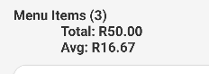
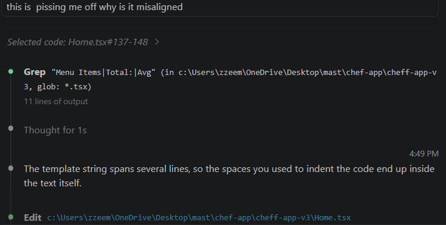
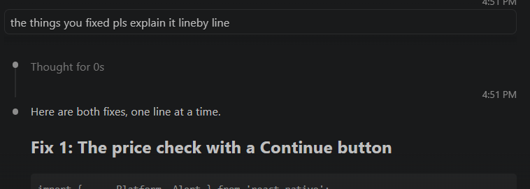

# Chef's Menu Manager

**Module:** MAST5112 – Mobile App Scripting
**Assessment:** PoE Part 3 – Final PoE
**Student:** Mohamed Zaeem Motala (ST10515004)

> **Submission note:** this repository is my **PoE Part 3 (Final PoE)** submission. It builds on my Part 2 app (add and view menu items, with validation and feedback messages, plus search, edit and delete), and adds a search box and a dish type filter to the Details screen, a confirmation before a dish is deleted, and a shared file of reusable functions. The changes made for Part 3 are listed under [Part 3 changes](#part-3-changes).

## About the app

Chef's Menu Manager is a React Native (Expo) Android app built for Christoffel, a restaurant owner whose chef currently keeps menu information on paper. The app lets the chef capture dishes on a phone and see the whole menu in one place.

The app code is in the [`cheff-app-v3`](./cheff-app-v3) folder.

## Features

- Add a menu item with a dish name, cooking time, description, price and dish type.
- Pick the dish type from a dropdown (Appetizer, Main Course, Dessert, Beverage).
- Validation on every field, with a clear error message for each:
  - the name, time, description, price and dish type are all required
  - the price must be a number greater than 0
- A success message ("Dish added successfully!") after a dish is saved.
- A price check: if the price is over R400, the chef is asked to confirm it and can press Cancel to change it or Continue to save the dish anyway.
- The menu list updates straight away when a dish is added, and the list is saved on the device with AsyncStorage, so it is still there when the app is reopened.
- A summary line showing the number of dishes, the total price and the average price.
- A Details screen (opened with the **Details** button) that groups dishes by type and shows a count and average price for each type.
- Search by dish name, edit a dish, delete a dish.
- **New in Part 3:** when the chef is editing a dish, a **Cancel** button shows under the form. Pressing it clears the form and stops editing, and nothing is saved.
- **New in Part 3:** I added a **✕** button to the search box on both screens. It only shows when something is typed, and pressing it clears the search so all the dishes show again.
- **New in Part 3:** before a dish is deleted, the chef is asked "Delete dish?" and can press **Cancel** to keep it or **Delete** to remove it.
- **New in Part 3:** a search box on the Details screen. While the chef types, only the matching dishes are shown, and any dish type with no matches is hidden. If nothing matches, the message "Cannot find any matching dishes." is shown.
- **New in Part 3:** a dish type filter on the Details screen. The chef can pick "All Categories" or one dish type, and only that dish type's card is shown.

## Screens

| Screen  | Purpose                                                              |
| ------- | -------------------------------------------------------------------- |
| Home    | Form for adding dishes, search bar, and the list of menu items       |
| Details | Search bar, dish type filter, menu summary and dishes grouped by dish type |

Navigation uses React Navigation (native stack): Home → Details.

## Tech stack

- React Native 0.81 with Expo SDK 54 (React Native, n.d.; Expo, n.d.a)
- TypeScript
- React Navigation (native stack)
- `@react-native-picker/picker` for the dish type dropdown
- `@react-native-async-storage/async-storage` for saving the menu
- React 19.1 (React, n.d.)
- `react-native-screens` and `react-native-safe-area-context`, which React Navigation uses (React Native Screens, n.d.; React Native Safe Area Context, n.d.)

## How to run

1. Install [Node.js](https://nodejs.org/) and the Expo Go app on your Android phone (or set up an Android emulator).
2. Clone the repo and go into the app folder:
   ```
   git clone https://github.com/EMGPSD/mast5112-2026-part-3-poe-st10515004.git
   cd mast5112-2026-part-3-poe-st10515004/cheff-app-v3
   ```
3. Install the dependencies:
   ```
   npm install
   ```
4. Start the app:
   ```
   npx expo start
   ```
5. Scan the QR code with Expo Go, or press `a` to open it on an Android emulator.

## How the code works

This section explains the main ideas behind the search box and the menu list in `Home.tsx`.

### Searching the menu

1. **A state variable stores what the chef types.** `const [searchItem, setSearchItem] = useState('');` creates it, and it starts as an empty string.
2. **The search box keeps that state up to date.** The `TextInput` is given `value={searchItem}` and `onChangeText={(text) => setSearchItem(text)}`. Each time a key is pressed, `setSearchItem` saves the new text. Changing state makes React run the component again (a re-render), so the screen always shows the latest results.
3. **`.filter` builds the list that is shown.**

   ```tsx
   const displayedItems = menuItems.filter((dish) =>
     dish.name.toLowerCase().includes(searchItem.toLowerCase().trim())
   );
   ```

   `.filter` goes through the dishes one at a time and asks a yes/no question about each one: does this dish's name contain the search text? Dishes that answer yes are kept and the rest are left out. In this code:
   - `.toLowerCase()` is applied to both the name and the search text, so capital letters are ignored ("pasta" still finds "Pasta").
   - `.trim()` removes spaces from the start and end of the search text.
   - `.includes(...)` is true when the search text appears anywhere in the name.

   When the search box is empty, every name contains an empty string, so every dish is kept.

How it all fits together:

```
type "pa" → setSearchItem("pa") → component re-renders
          → filter keeps only names containing "pa"
          → displayedItems = [Pasta, Paella]
          → .map draws a card for each
```

The full list (`menuItems`) is never changed by a search. Each re-render only creates a temporary filtered copy.

### Showing a message when the list is empty

The list uses a ternary operator, which is a short if/else that returns a value:

```
condition ? valueIfTrue : valueIfFalse
```

Because it is an expression, it can sit directly inside the JSX. React gets exactly one thing to display:

```tsx
{displayedItems.length === 0 ? (          // is there nothing to show?
  <Text>...message...</Text>              // yes → show a message
) : (                                     // no → ...
  displayedItems.map((item) => (...card...))   // ...show one card per dish
)}
```

If the list is empty, a single message is shown ("No matching dishes found." during a search, or "No menu items available. Please add a new dish." when the menu is empty). Otherwise React shows the array of cards created by `.map`. The brackets around each branch are only there so the code is easier to read.

### Drawing the cards with `.map`

`.map` is a built-in array method. It goes through the array one item at a time, runs a function on each item, and returns a new array made of the results. The original array is not changed.

```ts
const prices = [50, 80, 120];
const doubled = prices.map((p) => p * 2);
// doubled = [100, 160, 240]
```

In the app, `displayedItems.map((item) => ...)` returns a `<View>` card for each dish, filled with that dish's own name, time, description, price and type. With three dishes it returns three cards, and React draws them one under the other:

```
displayedItems = [
  { name: 'Pasta', price: 12, ... },   → card 1: Pasta, R12
  { name: 'Steak', price: 45, ... },   → card 2: Steak, R45
  { name: 'Cake',  price: 30, ... },   → card 3: Cake, R30
]
```

Each card is given `key={item.id}`. React needs a unique key on every item in a rendered list so it can tell the cards apart. That way, when one dish is edited or deleted, only that card is updated. Without keys, React shows a warning.

Whenever `displayedItems` changes (a dish is added, edited or deleted, or the search text changes), React runs the `.map` again from the start and redraws the list with the new data.

### Confirming a high price

I wanted the app to warn the chef when a price looks too high, but not to block it, because a dish over R400 is still possible. My first attempt was:

```tsx
if (!price || Number(price) > 400) { alert('Are you sure about the price?'); return; continue; }
```

This did not work, and I used an AI assistant (Claude) (Anthropic, 2026a) to help me understand why. What I learned:

- `continue` only works inside a loop, so it caused an error here. It also came after `return`, so it could never have run.
- `alert()` can only show a message with an OK button. It cannot give the user a choice, so it could not offer "go back" or "carry on".
- `!price` was in the same check, so an empty price showed "Are you sure about the price?" instead of "Please enter a price".

The fix in `Home.tsx`:

1. The checks for an empty price, a valid number and a dish type now run first. I moved the dish type check above the price pop-up, because before, the chef could press Continue on the price and only then get told to pick a dish type.
2. If the price is over 400, the app shows a pop-up with two buttons, **Cancel** and **Continue**, and waits for the answer:
   - **Continue** saves the dish as normal, so the chef is not stuck with a R400 limit.
   - **Cancel** saves nothing and keeps the form filled in so the price can be changed.
3. `Alert` was added to the `react-native` import. On the web, the browser's built-in `confirm` box is used instead, because `Alert.alert` buttons do not work in a browser.

### Fixing the misaligned summary text

The summary above the menu list showed up misaligned: "Total" and "Avg" were pushed to the right of "Menu Items". I could not work out why, so I asked Claude Code (the Claude assistant inside my code editor) (Anthropic, 2026d). Claude Code does not have a share-chat link, so I have saved screenshots of the conversation in the [`screenshots`](./screenshots) folder.







**The cause:** the text was written as a template string (text inside backticks) that continued over several lines. A template string keeps everything exactly as typed, so the spaces I used to indent the code ended up inside the text itself and pushed "Total" and "Avg" to the right.

**The fix:** the text is now written on one line, with `\n` marking where each new line starts. The result is `Menu Items (3)`, then `Total: R50.00`, then `Avg: R16.67`, all lined up.

```tsx
`Menu Items (${menuItems.length})\nTotal: R${totalPrice.toFixed(2)}\nAvg: R${averagePrice.toFixed(2)}`
```

After the fix I asked Claude Code (Anthropic, 2026d) to explain each change line by line so that I understood it, and not only copied the answer.

## Part 3 changes

### Search on the Details screen

The Details screen (`Details.tsx`) now has its own search box at the top. It works like this:

1. **A state variable stores the search text.** `const [searchItem, setSearchItem] = useState("");` starts as an empty string, and the `TextInput` updates it every time a key is pressed.
2. **The matching dishes are worked out once.** `const results = searchDishes(menuItems, searchItem);` uses the shared search function from `reusable.tsx` (see [Reusable functions](#reusable-functions)), so the Details screen searches in exactly the same way as the Home screen.
3. **Each dish type card filters its own dishes.** The screen uses `dishTypes.map(...)` to make one card per dish type. Inside each card, `results.filter((item) => item.dishType === type.value)` keeps only the matching dishes that belong to this dish type.
4. **Cards with no matches are hidden.** `if (searchItem && dishes.length === 0) return null;` means: if the chef is searching and this dish type has no matching dishes, draw nothing for it. In React, returning `null` shows nothing.
5. **A message is shown when nothing matches.** `visibleDishes` keeps only the dishes that match the search and the picked dish type. If something is typed and `visibleDishes.length === 0`, the app shows "Cannot find any matching dishes." when "All Categories" is picked. If a dish type is picked, the message says which one, for example `No Dessert dishes match "pasta".`
6. **The average price per dish type** comes from `getAveragePrice(dishes)`, which adds up the prices with `.reduce` and divides by the number of dishes. If a dish type has no dishes, the average is 0, so the screen never shows "NaN".

When the search box is empty, every dish matches, so all the cards are shown as normal. The Summary card shows the total dishes, the total value and the average price. It always uses the whole menu, not only the search results.

```
type "cake" → setSearchItem("cake") → screen re-renders
            → each dish type card keeps only names containing "cake"
            → dish types with no cake are hidden (return null)
            → Dessert (1): Chocolate Cake
```

### Filter by dish type on the Details screen

Under the search box there is a dropdown (`Picker`) with "All Categories" and the four dish types.

1. **A state variable stores the chosen dish type.** `const [selectedType, setSelectedType] = useState("");` starts empty, which means "All Categories".
2. **The dropdown options come from the shared `dishTypes` list**, so they always match the Home screen picker.
3. **Other dish types are skipped.** Inside `dishTypes.map(...)`, `if (selectedType && type.value !== selectedType) return null;` means: if a dish type is chosen and this card is a different one, draw nothing for it.

The filter and the search work together. For example, choosing Dessert and typing "cake" shows only the Dessert card, with only the dishes that contain "cake".

### Confirming before a dish is deleted

Pressing **Delete Dish** on the Home screen used to remove the dish straight away. Now `deleteMenuItem` first shows a pop-up with `Alert.alert` titled "Delete dish?" with two buttons:

- **Cancel** keeps the dish.
- **Delete** removes it, updates the list and saves the new list with `saveDishes`.

The pop-up is wrapped in a `Promise` so the function waits for the chef's answer. `if (!confirmDelete) return;` stops the delete when Cancel is pressed.

### Reusable functions

Code that both screens need is written once in `reusable.tsx` and imported where it is used:

| Name | What it does | Used in |
| ---- | ------------ | ------- |
| `MenuItem` | What one dish looks like (`id`, `name`, `time`, `description`, `price`, `dishType`). I use it instead of `any[]` so TypeScript can catch mistakes | Home, Details, navigation |
| `dishTypes` | The four dish types (value saved, label shown) | Home picker, Details filter and cards |
| `searchDishes(dishes, searchText)` | Keeps only dishes whose name contains the search text (ignores capitals and extra spaces) | Home, Details |
| `getTotalPrice(dishes)` | Adds up all the prices (bad prices count as 0) | Home, Details |
| `getAveragePrice(dishes)` | Total divided by the number of dishes, or 0 if there are none | Home, Details |
| `saveDishes(dishes)` | Saves the list to the phone with AsyncStorage | Home |
| `SearchBar` | The same search box component on both screens, with a ✕ button that clears the search | Home, Details |

This means a change (for example, adding a new dish type) only has to be made in one place.

### Upgrading to Expo SDK 58

The project was upgraded from Expo SDK 57 to SDK 58 (React Native 0.88) so it runs on the current version of Expo Go.

### Moving back to Expo SDK 54

On SDK 58 the splash screen only showed the app name and not my logo, so I added a loading screen with a delay in `navigation.tsx` to show the logo. I then moved the project back to Expo SDK 54 (React Native 0.81). On SDK 54 the `expo-splash-screen` plugin (Expo, n.d.b) shows my logo as soon as the app launches, so the logo now appears without needing the loading screen.

The downgrade also changed:

- `expo-status-bar` (Expo, n.d.c) was removed from the `plugins` list in `app.json`, because on SDK 54 it is not a config plugin.
- `expo-system-ui` (Expo, n.d.d) was added, so the light mode setting (`userInterfaceStyle`) in `app.json` works on Android.

### Fixing the Details screen layout

My first attempt at the Details search put the new `TextInput` and results list above the `return`, and then before the `<ScrollView>`. Nothing showed up and the file stopped working. I used Claude Code (Anthropic, 2026e) to help me understand why:

- Only what is inside `return ( ... )` is drawn on the screen.
- A `return` can only hold **one** outer element. Here that element is the `<ScrollView>`, so everything else has to go inside it.
- Inside JSX, comments have to be written as `{/* comment */}`, not `//`.

I also asked Claude Code to explain `.map`, `.filter`, `.reduce`, `.length`, `type.value` and `item` in plain words.

## Design decisions and changes from Part 1

- **Dish types.** The app uses four dish types: Appetizer, Main Course, Dessert and Beverage. My Part 1 design used three courses, and I added Beverage and used the label "Appetizer" because more variety makes it easier for the chef to organise the menu. The picker, the menu cards and the Details screen all use the same four types.
- **Splash screen.** While the app starts up, my chef-hat logo is shown on a plain white splash screen. It is set up with the `expo-splash-screen` plugin in `app.json`, using my app icon (`icon.png`). In `navigation.tsx` I also added a small screen with a delay that displays my app icon for 1.5 seconds before the Home screen opens. I added it because on SDK 58 the splash screen did not show my logo. Since moving back to SDK 54, the splash screen shows the logo on its own (see "Moving back to Expo SDK 54").
- **Messages.** Validation errors, the high price confirmation and the success message tell the chef what happened after every action.
- **Display screen.** In my Part 1 design I made a monolith design, which is a one-page design: the full app was hosted on one page. In Part 3 I have added a new screen, the Details page. The Details page displays all the user's added menu items and has a search bar and a picker for a filter. This picker allows users to select the dish type. When a dish type is selected, it hides the dish types that do not apply and displays only the ones of the selected type.


## Video demonstration

YouTube (Unlisted): https://youtu.be/IrK2ZIFfQ-o

## References

I used Google to find out how to install and set up the AsyncStorage, Picker and React Navigation packages (Google, 2026a). The installation steps came from the official documentation for each package (React Native Async Storage, n.d.; React Native Community, n.d.; React Navigation, n.d.). I also used a Google search to find the command for installing the splash screen (Google, 2026b). The app icon and loading screen image were generated with the help of Grok (xAI, 2026), and I used Claude as a coding and learning aid (for example, to understand and fix the price confirmation and the misaligned summary text described above) and to help format my work and understand the assignment brief (Anthropic, 2026a; 2026b; 2026c).

Anthropic. 2026a. Claude (Sonnet 5.5). [Large language model]. Available at: https://claude.ai/share/321c6eac-e7e9-4270-8f79-43b30c067c0e [Accessed: 11 October 2026].

Anthropic. 2026b. Claude (Sonnet 5.5). [Large language model]. Available at: https://claude.ai/share/6830cd57-0ae1-4700-ba99-6ee67f2e0ea3 [Accessed: 11 October 2026].

Anthropic. 2026c. Claude (Sonnet 5.5). [Large language model]. Available at: https://claude.ai/share/397adc4e-30aa-4014-8a47-bbfb5ac11e7b [Accessed: 12 October 2026].

Anthropic. 2026d. Claude Code (Opus 5.5). [Large language model]. Screenshots of the conversation are saved in the `screenshots` folder of this repository (ai-help-1, ai-help-2 and ai-help-3). [Accessed: 11 October 2026].

Anthropic. 2026e. Claude Code (Opus 5.5). [Large language model]. Screenshots of the conversation are saved in the `screenshots` folder of this repository. [Accessed: 3 November 2026].

Anthropic. 2026f. Claude (Sonnet 5.5). [Large language model]. Available at: https://claude.ai/share/13a4b6f5-76df-4055-99da-db5440d49549 [Accessed: 3 November 2026].

Anthropic. 2026g. Claude Code (Opus 5.5). [Large language model]. Used to update this README so it describes the Part 3 changes. Screenshots of the conversation are saved in the `screenshots` folder of this repository. [Accessed: 16 November 2026].

Anthropic. 2026h. Claude Code (Opus 5.5). [Large language model]. Used to update this README so it describes my latest changes. Screenshots of the conversation are saved in the `screenshots` folder of this repository. [Accessed: 18 November 2026].

Expo. n.d.a. Expo documentation. Available at: https://docs.expo.dev/ [Accessed: 17 November 2026].

Expo. n.d.b. SplashScreen (expo-splash-screen). Available at: https://docs.expo.dev/versions/latest/sdk/splash-screen/ [Accessed: 17 November 2026].

Expo. n.d.c. StatusBar (expo-status-bar). Available at: https://docs.expo.dev/versions/latest/sdk/status-bar/ [Accessed: 17 November 2026].

Expo. n.d.d. SystemUI (expo-system-ui). Available at: https://docs.expo.dev/versions/latest/sdk/system-ui/ [Accessed: 17 November 2026].

Google. 2026a. Search results for installing `@react-native-async-storage/async-storage`, `@react-native-picker/picker` and React Navigation in an Expo project. [Google Search]. Available at: https://www.google.com [Accessed: 11 October 2026].

Google. 2026b. What is the command to install the splash screen on react native. [Google Search]. Available at: https://www.google.com/search?q=what+is+the+command+to+install+the+splash+screen+on+react+native [Accessed: 11 October 2026].

The Independent Institute of Education (IIE). 2026a. Guidelines for responsible AI use at The IIE (PDIIE023). [pdf] The Independent Institute of Education. Available at: IIE internal resource [Accessed: 12 October 2026].

The Independent Institute of Education (IIE). 2026b. Harvard-Anglia style reference guide — adapted for The IIE. [pdf] The Independent Institute of Education. Available at: IIE internal resource [Accessed: 12 October 2026].

React. n.d. React documentation. Available at: https://react.dev/ [Accessed: 17 November 2026].

React Native. n.d. React Native documentation. Available at: https://reactnative.dev/docs/getting-started [Accessed: 17 November 2026].

React Native Async Storage. n.d. Install. Available at: https://react-native-async-storage.github.io/async-storage/docs/install/ [Accessed: 11 October 2026].

React Native Community. n.d. @react-native-picker/picker. Available at: https://github.com/react-native-picker/picker [Accessed: 11 October 2026].

React Native Safe Area Context. n.d. react-native-safe-area-context. Available at: https://github.com/AppAndFlow/react-native-safe-area-context [Accessed: 17 November 2026].

React Native Screens. n.d. react-native-screens. Available at: https://github.com/software-mansion/react-native-screens [Accessed: 17 November 2026].

React Navigation. n.d. Getting started. Available at: https://reactnavigation.org/docs/getting-started [Accessed: 11 October 2026].

xAI. 2026. Grok (4.7). [Generative AI tool]. Used to generate the chef logo for the app icon and loading screen. Available at: https://grok.com/share/c2hhcmQtNA_34351c59-14d1-4938-8152-8c70ba49f78a [Accessed: 11 October 2026].

> ⚠️ Disclaimer: All references provided or formatted by Claude must be verified by Mohamed before submission. Claude may make errors in referencing. It is Mohamed's responsibility to ensure all references are accurate and comply with the IIE Harvard-Anglia Style Guide (2026).

## Disclosure of AI Usage in my Assessment

In line with the IIE Guidelines for responsible AI use (PDIIE023) (IIE, 2026a), this annexure lists every use of generative AI in MAST5112 Part 2 and Part 3. The code logic, structure and wording in this repository are my own. Claude formatted this annexure and the reference list.

| Section of this assessment | AI tool | Purpose | Date(s) used | Link / evidence |
| -------------------------- | ------- | ------- | ------------ | --------------- |
| *How the code works*: "Confirming a high price" | Claude (Anthropic, 2026a) | A coding and learning aid: understanding why my price confirmation did not work and how to fix it. | 11 October 2026 | https://claude.ai/share/321c6eac-e7e9-4270-8f79-43b30c067c0e |
| *How the code works*: "Fixing the misaligned summary text" | Claude Code (Anthropic, 2026d) | Finding and understanding the cause of the misaligned summary text, and explaining the fix line by line. | 11 October 2026 | Screenshots in the `screenshots` folder |
| Whole of Part 2 (brief, rubric and app review) | Claude (Anthropic, 2026b) | Understanding the assignment brief and helping to format my work. | 11 October 2026 | https://claude.ai/share/6830cd57-0ae1-4700-ba99-6ee67f2e0ea3 |
| Whole of Part 2 (hints and feedback) and this README | Claude (Anthropic, 2026c) | Hints and feedback only: summarising the Part 2 brief and rubric, pointing out where my app did not match the brief or my Part 1 design, estimating how the rubric might be applied, and formatting the reference list and this annexure. Claude did not write my app code. I made the changes to my code myself. | 6 October 2026 and 12 October 2026 | https://claude.ai/share/397adc4e-30aa-4014-8a47-bbfb5ac11e7b |
| Whole of Part 3 (hints and feedback) | Claude (Anthropic, 2026f) | Hints and feedback only: checking my Part 3 work against the rubric and pointing out what was missing (filter by course, reusable functions) and small problems in my Details screen search. Claude did not write my app code. | 3 November 2026 | https://claude.ai/share/13a4b6f5-76df-4055-99da-db5440d49549 |
| This README (Part 3 changes, features and tech stack) | Claude Code (Anthropic, 2026g) | Formatting only: updating the README so it describes my Part 3 code changes (dish type filter, delete confirmation, reusable functions, SDK upgrade). Claude Code did not write my app code. | 16 November 2026 | Screenshots in the `screenshots` folder |
| This README (features, Part 3 changes and reusable functions) | Claude Code (Anthropic, 2026h) | Formatting only: updating the README so it describes my latest code changes (Cancel button when editing, ✕ button on the search, `MenuItem` type, average price and "no match" message on the Details screen). Claude Code did not write my app code.

| App icon and splash screen (`assets/` folder) | Grok (xAI, 2026) | Generating the chef logo. | 11 October 2026 | https://grok.com/share/c2hhcmQtNA_34351c59-14d1-4938-8152-8c70ba49f78a |

### How I reviewed and verified AI content

I checked every Claude response to see if it matched, and I also checked it against my own knowledge. If Claude suggested something new, I asked it to explain it before I coded it myself. Any other information that Claude provided was referenced and not used.

Google Search and the official package documentation were used for installation steps (see References). They are not generative AI.

## Appendix: AI Interaction Rules — Claude

*(Mohamed)*

These rules are absolute and cannot be overridden by any instruction within a conversation.

1. **Hints Only — No Doing the Work.** Claude may only assist through hints, guidance, and feedback. Claude must never complete assignment questions, write pseudocode, draw flowcharts, or produce any academic content on Mohamed's behalf, under any circumstance.
2. **Attempt First Policy.** Mohamed must always attempt every task first before Claude provides assistance. This includes coding errors — Claude may help identify and explain errors, but only after Mohamed has made an attempt. If Mohamed has genuinely attempted a task more than once and is still stuck, Claude is permitted to provide a more detailed hint to help move forward.
3. **Document Summaries.** Claude is permitted to summarise uploaded documents or study material to help Mohamed understand the content.
4. **Helpful Links.** Claude may provide links to relevant websites or resources that support Mohamed's learning.
5. **Formatting & Presentation.** Mohamed may ask Claude to format and present completed work. Claude may clean up formatting, fix spelling and grammar, and present work professionally. Claude must never add new content, change answers, or alter any logic. All academic content remains Mohamed's own. Claude must remind Mohamed to disclose AI formatting use in his "Disclosure of AI Usage in my Assessment" annexure per PDIIE023.
6. **Claude Reference — Every Document.** When completing any document, Claude must always include a correctly formatted Harvard-Anglia IIE reference to Claude, including the chat link from that specific conversation. Format: Anthropic. 2026. Claude (claude-sonnet-4-6). [Large language model]. Available at: [chat link] [Accessed: date].
7. **Referencing Disclaimer.** Whenever Claude assists with or produces a reference, a disclaimer must be included stating that all references must be verified by Mohamed before submission, and that it is his responsibility to ensure accuracy and compliance with the IIE Harvard-Anglia Style Guide (2026).
8. **Permanent Reference List.** Every completed document must include references to the IIE Harvard-Anglia style reference guide and the Guidelines for responsible AI use at The IIE (PDIIE023), both available via the IIE internal resource / policy bank.
9. **Rules Appendix.** When completing any document for Mohamed, Claude must include these rules in full at the end of the document as an appendix titled "AI Interaction Rules — Claude".
